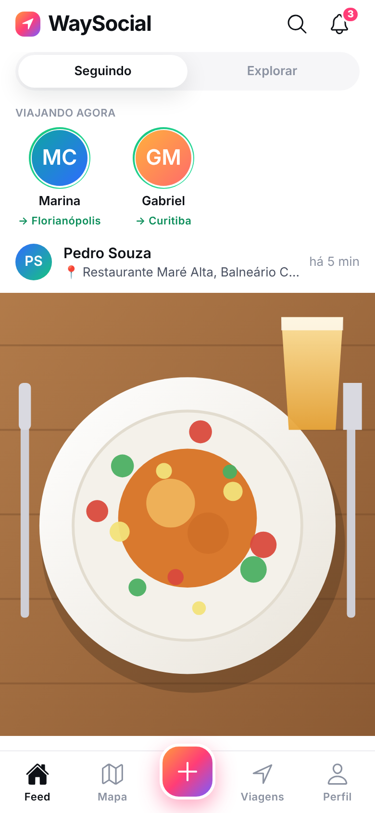
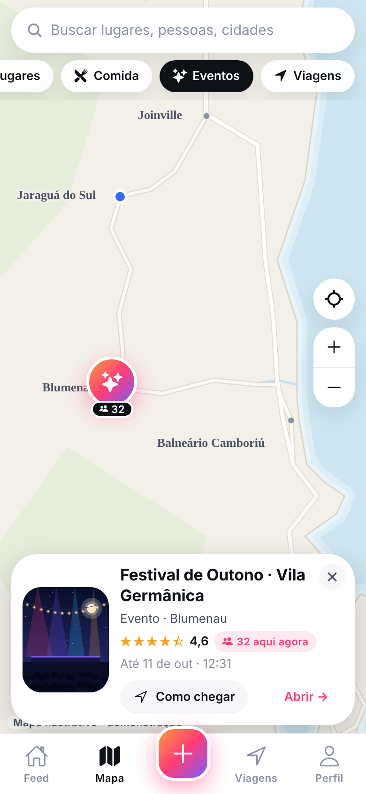
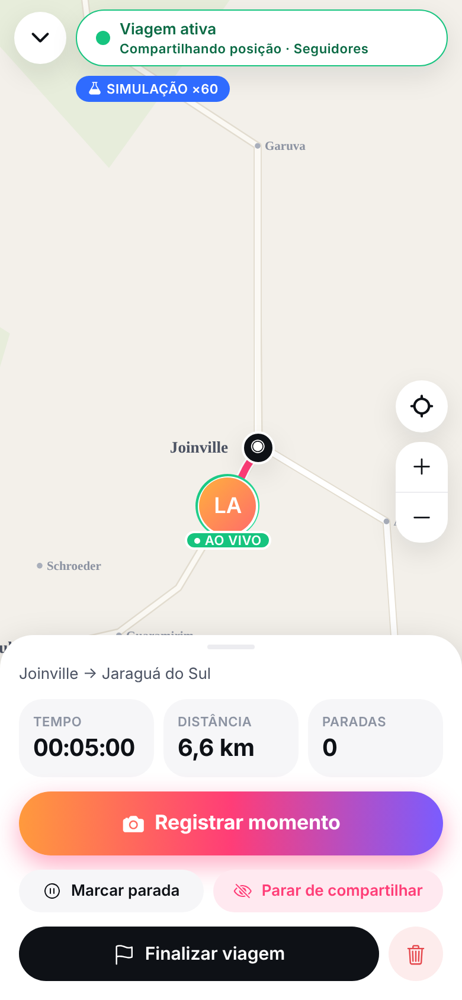
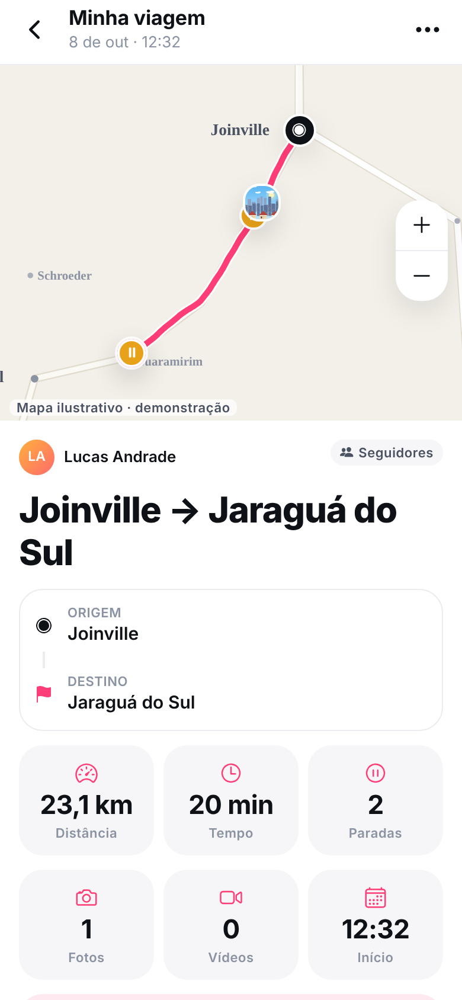
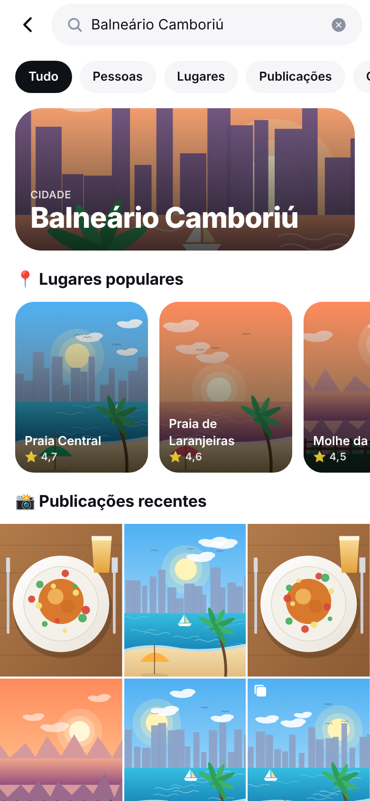

# WaySocial

> **Compartilhe o mundo enquanto você vive.**
> Rede social do mundo real: **feed + mapa + localização + viagens** — nem só um Waze, nem só um Instagram, nem só um diário de viagem.

<p align="center">
  
  
  
  
  
</p>

O app abre já com um mundo fictício vivo (5 pessoas, 6 cidades, ~40 publicações, viagens, uma delas ao vivo) para você **ver como o produto funciona** sem configurar nada. Quando quiser dados reais, é só apontar para um projeto Supabase — a interface é a mesma.

- **Feed social** — fotos/vídeos, curtir (toque duplo), comentar, salvar, compartilhar.
- **Mapa social** — o que está acontecendo perto: publicações, lugares, eventos, restaurantes e pessoas **viajando agora**.
- **Viagens** — grava o trajeto, as paradas e os momentos; ao chegar, gera o resumo (distância, tempo, paradas, fotos, vídeos).
- **Privacidade em primeiro lugar** — a localização exata nunca é compartilhada sem você escolher. Veja [docs/PRIVACY.md](docs/PRIVACY.md).

## Rodando (1 minuto)

Requisitos: Node 20+ e o app **Expo Go** no celular (ou um navegador).

```bash
npm install
npx expo start          # escaneie o QR no Expo Go · pressione "w" para abrir no navegador
```

Na tela inicial, toque em **“Explorar com a conta demo”** (Lucas — `lucas@waysocial.demo`, senha `waysocial`).
Tudo funciona offline: dados em AsyncStorage, mapa ilustrativo, IA simulada.

> **Sem sair de casa:** em *Viagens → Começar viagem* há o modo **Simulação**, que "dirige" por uma rota (1 s real ≈ 1 min de viagem). Dá para ver cronômetro, distância, paradas automáticas, registrar momentos e finalizar em poucos segundos.
> Em *Configurações → Demonstração* há um botão que simula interações de outros usuários (curtidas, comentários, seguidores) para você ver as notificações chegando.

### Com Supabase (dados reais)

```bash
cp .env.example .env.local        # preencha EXPO_PUBLIC_SUPABASE_URL e EXPO_PUBLIC_SUPABASE_ANON_KEY
supabase link --project-ref <ref> && supabase db push     # aplica supabase/migrations
# opcional: supabase db reset (local) carrega também supabase/seed.sql com o mundo de demonstração
npx expo start --clear
```

Guia completo (Auth, Storage, Realtime, RLS): [docs/DATABASE.md](docs/DATABASE.md).

## O que o MVP entrega

| # | Pedido | Onde |
|---|---|---|
| 1 | Cadastro/login | `src/app/(auth)/*` · `services/auth.ts` (mock e Supabase Auth) |
| 2 | Feed | `src/app/(tabs)/index.tsx` · `components/PostCard.tsx` |
| 3 | Perfil (Publicações · Viagens · Lugares + mapa) | `features/profile/ProfileBody.tsx` |
| 4–6 | Criar publicação, foto, localização | `src/app/compose.tsx` · `place-picker.tsx` · `features/compose/*` |
| 7 | Mapa (marcadores, cartão, clusters, filtros) | `src/map/*` · `src/app/(tabs)/map.tsx` |
| 8–10 | Curtidas, comentários, seguir (+ perfil privado com aprovação) | `PostCard`, `post/[id].tsx`, `ProfileBody` |
| 11 | Página do lugar (nota, fotos, quem esteve, como chegar, publicar aqui) | `src/app/place/[id].tsx` |
| 12–15 | Viagem: criar, registrar pontos, finalizar, resumo | `state/TripSession.tsx` · `features/trip/*` · `src/app/trip/*` |
| 16 | Navegação `Feed · Mapa · + · Viagens · Perfil` | `components/TabBar.tsx` |
| + | Busca (pessoas, lugares, publicações, cidades) | `src/app/search.tsx` |
| + | Notificações (seguidor, curtida, comentário, pedido, salvo) | `src/app/notifications.tsx` |
| + | Conquistas | `domain/achievements.ts` · `src/app/achievements.tsx` |
| + | IA (legendas, resumo; vídeo = futuro) | `services/ai.ts` · [docs/AI.md](docs/AI.md) |

Fica para depois (arquitetura já preparada): vídeo gerado por IA, eventos criados por usuários, estabelecimentos, publicidade, recomendações — veja [docs/ROADMAP.md](docs/ROADMAP.md).

## Stack

- **App:** React Native + **Expo SDK 57** (Expo Router, TypeScript estrito, React Compiler). Roda no iOS, Android e web.
- **Backend:** **Supabase** — Postgres + RLS, Auth, Storage (bucket privado com URL assinada), Realtime.
- **Mapas:** motor Web Mercator próprio (sem módulo nativo, funciona no Expo Go) com **ponto único de troca** para Mapbox/MapLibre — [docs/MAPS.md](docs/MAPS.md).
- **Sem dependência de API paga para rodar.** Nenhuma chave de mapa/IA é necessária no MVP.

## Arquitetura em 30 segundos

```
UI (src/app, components)  ──►  WayRepository (contrato)  ──►  MockRepository      (AsyncStorage + seed)
                                                          └─►  SupabaseRepository (Postgres + RLS)
        │                                          ▲
        └── SocialMap (contrato) ─► RasterMap      └── regras de privacidade: domain/privacy.ts (cliente)
            AiProvider  ─► Mock | HTTP              └── e supabase/migrations (servidor — a que vale)
            AuthService ─► Mock | Supabase
```

A UI só conhece interfaces. Trocar mock por Supabase, mapa ilustrativo por tiles reais ou IA simulada por um modelo é **configuração**, não reescrita. Detalhes em [docs/ARCHITECTURE.md](docs/ARCHITECTURE.md).

## Testes e qualidade

```bash
npm run typecheck     # tsc (app + scripts)
npm run lint          # eslint (expo + React Compiler rules) — 0 erros
npm test              # 86 testes: geo, privacidade, conquistas, repositório mock, gravação de viagem, IA, clusters
npm run db:test       # 13 testes de RLS/privacidade em Postgres 16 descartável (sem Docker)
npm run db:integration# 22 testes do SupabaseRepository contra Postgres + PostgREST reais
npm run test:e2e      # 30 verificações da jornada completa no navegador (Playwright), com screenshots
```

O que **foi** verificado: todos os comandos acima, `expo-doctor` (21/21) e o bundle nativo iOS (Hermes).
O que **não** foi verificado (precisa de você): execução em aparelho físico/emulador (câmera, GPS nativo, gestos de pinça), Supabase Auth real (GoTrue), upload/URL assinada no Storage e Realtime num projeto hospedado, e CI no GitHub Actions. Está tudo implementado e tipado, mas só foi exercitado até a camada de banco/HTTP descrita acima.

## Estrutura

```
src/
  app/            rotas (Expo Router): (auth), (tabs), compose, trip/*, place/*, user/*, search...
  components/     UI reutilizável (PostCard, TabBar, SceneArt, Sheet, ...)
  domain/         tipos + regras puras (privacidade, conquistas, estatísticas de viagem)
  data/           repository.ts (contrato) · mock/ (demo) · supabase/ (produção)
  features/       compose · map · profile · trip (recorder, GPS, simulação)
  map/            SocialMap: contrato, RasterMap, mapa ilustrativo, marcadores, clusters
  services/       auth · ai · geocoding · composição (index.ts)
  state/          providers React (serviços, sessão, viagem ativa) e useQuery
supabase/         migrations, seed.sql (gerado), config.toml, tests (RLS) 
scripts/          gerador do seed SQL · teste de integração · ícones
e2e/              jornada ponta a ponta (Playwright)
docs/             arquitetura, banco, mapas, IA, privacidade, roadmap
```

## Licença

Ainda não definida — o repositório é privado e o código é seu. Escolha uma licença antes de abrir o código.
